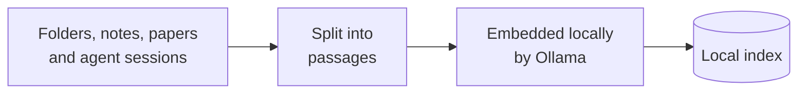
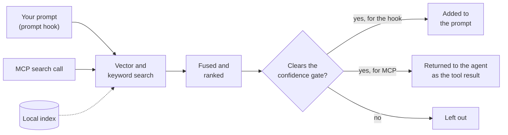
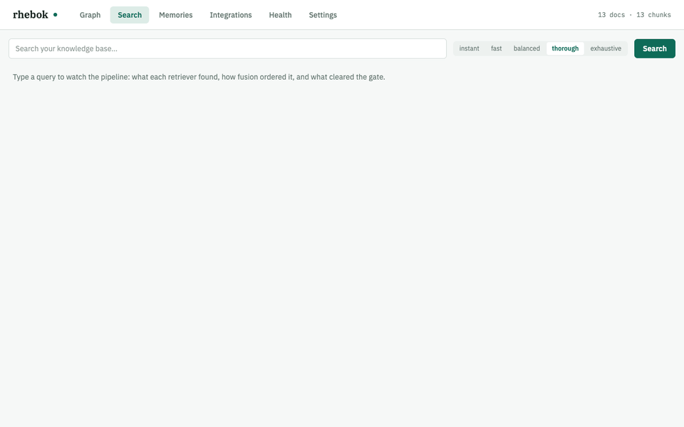

Your coding agent starts every session knowing nothing you have not pasted in.
The decision you wrote up last month, the fix you found in yesterday's
session, the paper in your Downloads folder: it can use none of them unless
you find them and hand them over.

rhebok hands them over. It indexes the folders you point it at, embeds them
with a small model running on your own machine through
[Ollama](https://ollama.com), and serves the results two ways:

- **Automatic context.** A prompt hook adds the most relevant passages to
  every prompt, but only when they clear a confidence gate.
- **On-demand search.** An MCP tool lets the agent search your knowledge base
  whenever it decides to.

It works with Claude Code, Codex, Gemini CLI, Cursor and Claude Desktop. It
also keeps durable memories (lessons and facts that carry across sessions) and
has a local web dashboard for searching, exploring and configuring everything.

## How it works

rhebok does two jobs. In the background, it keeps an index of what you point it at:

Then, on every prompt, and whenever the agent calls the MCP search tool, it searches that index:

At the `balanced` tier and above (tiers 2 to 4), search also follows the links
between notes and the neighbouring passages of each hit. The prompt hook runs
the `fast` tier (tier 1) by default, so it skips that step. MCP search runs
the `thorough` tier (tier 3) by default, so it takes it.
[Configuration and tuning](/guides/configuration) lists what each tier does.

Nothing leaves your machine unless you set it up to: embeddings run locally
and there is no telemetry. rhebok itself goes online only to check daily for a
newer release, to download its vector-search extension the first time it
builds an index, to fetch the OCR model from ModelScope the first time it reads
a scanned PDF (oar-ocr only; Apple Vision on macOS downloads nothing),
and to fetch pages you add with `rhebok add <url>`. If you turn them on, it
also sends text to an embedding endpoint you choose and backs up to your own
S3 bucket or Google Drive.

<CardGroup cols={2}>
  <Card title="Install" href="/get-started/install">
    Install rhebok and index your first folder in about ten minutes.
  </Card>
  <Card title="Using rhebok" href="/get-started/usage">
    Search, memories, the dashboard and connecting other agents.
  </Card>
  <Card title="Configuration and tuning" href="/guides/configuration">
    Sources, quality tiers, ranking weights and embedding options.
  </Card>
  <Card title="Troubleshooting" href="/guides/troubleshooting">
    What to check when rhebok injects nothing or an install fails.
  </Card>
</CardGroup>
